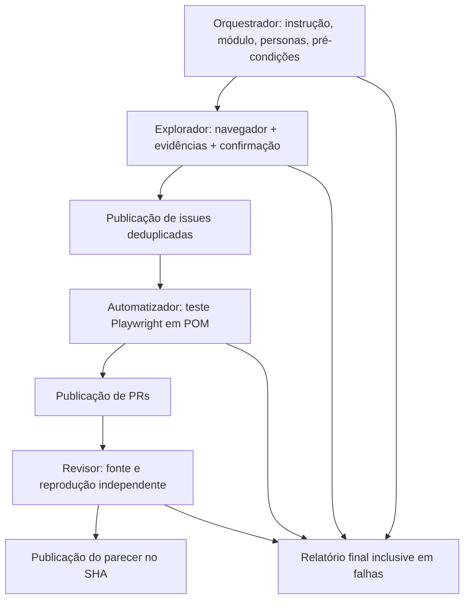

# OrangeHRM Quality Orchestrator

Auditoria de qualidade com **quatro agentes Codex**, Playwright, axe-core e GitHub Actions. Projeto de **loruhana**, com histórico Git independente.

[](https://github.com/loruhana/orangehrm-quality-orchestrator/actions/workflows/ci.yml)



## O que foi refinado

- O Orquestrador interpreta uma instrução em linguagem natural com Codex ou recebe um módulo explícito. O escopo é limitado aos casos realmente implementados.
- Pré-condições verificam ambiente autorizado, Chromium e identidade da publicação local. O executor não usa outra conta para publicar.
- Sem bugs confirmados, as próximas etapas são registradas como `skipped`, sem PRs artificiais. Falhas de infraestrutura são `inconclusive`, `partial` ou `blocked`, nunca sucesso inventado.
- No workflow manual, cada etapa possui um runner independente. Artifacts transferem o plano e as evidências; jobs sem IA publicam os resultados com permissões de escrita específicas.
- Relatórios ficam em `audit-output/` e no resumo do GitHub Actions, inclusive quando um job anterior falha.
- Todos os casos mapeados são executados diariamente às **08:30 e 16:00 no horário de Brasília**, sem depender de segredo de IA.

## Execução local

Node.js 22+, Git e PowerShell no Windows:

```powershell
npm ci
npx playwright install chromium
npx codex login
npm test
npm run demo
npm run pipeline -- --authorized --module all
```

Auditoria em linguagem natural:

```powershell
npm run pipeline -- --authorized --module auto --instruction "Audite o módulo de funcionários, sem alterar registros"
```

`auto` exige Codex. `--module PIM` tem precedência sobre inferências da IA. Use `--rules` com módulo explícito para validar a infraestrutura sem modelo; esse modo é determinístico e não deve ser apresentado como IA.

Para publicar, use `--publish` e `GITHUB_TOKEN` autenticado como **loruhana**, com permissão no repositório. No Windows com Git Credential Manager configurado:

```powershell
pwsh -File scripts/run-local.ps1
```

O atalho executa o pipeline completo. Não grave tokens em arquivos versionados. O processo Codex não recebe o token GitHub. Credenciais padrão do ambiente público: `Admin / admin123`. `.env.example` documenta variáveis, mas `.env` não é carregado automaticamente.

## GitHub Actions

| Workflow | Gatilho | O que executa |
|---|---|---|
| CI | Push, PR e manual | Testes unitários e controles Chromium com defeito/correção |
| Todos os testes | **08:30 e 16:00 BRT**, todos os dias, e manual | Cada caso de `src/catalog.js`, sem exclusão de bugs conhecidos |
| Auditoria IA | Botão **Run workflow** | Orquestrador → Explorador → publicação de issues → Automatizador → publicação de PRs → Revisor → publicação de pareceres → relatório |
| Live smoke | Manual | Cenários funcionais básicos preservados da base |

O cron usa **11:30 e 19:00 UTC**, equivalentes aos horários solicitados em UTC−3. GitHub pode atrasar execuções por filas e desabilitar schedules de repositórios públicos inativos; confira a aba Actions. Não se trata de garantia de início no segundo exato.

O workflow de todos os testes usa `npm run test:mapped`. Cada novo caso adicionado ao catálogo entra automaticamente nessa execução. Uma falha de produto deixa o job vermelho; relatórios HTML, JSON, screenshots e traces são publicados com `if: always()`. Não há `test.fail`, `test.skip` ou `continue-on-error` no passo dos testes para mascarar defeitos.

No workflow **Auditoria IA**, selecione módulo, instrução, provider e publicação. `provider=codex` exige o secret **OPENAI_API_KEY** com acesso à API; a sessão local ChatGPT não autentica runners hospedados. A implementação usa o Codex CLI para decisões estruturadas em cada estágio. `provider=rules` permite validar o encadeamento sem chave, com identificação explícita de ausência de IA.

Para publicar PRs com `GITHUB_TOKEN`, habilite **Settings → Actions → General → Allow GitHub Actions to create and approve pull requests**. O projeto apenas cria PRs e comentários; nunca faz merge ou autoaprovação formal. Commits de testes usam `loruhana` e seu endereço noreply. Não há commits do histórico anterior.

## Casos e limites

O catálogo contém 12 contratos: obrigatoriedade de login, credenciais inválidas, login válido, nomes acessíveis, três regras axe-core (`color-contrast`, `html-has-lang`, `link-name`) e navegação PIM, Leave, Time, Recruitment, Performance. PIM seleciona login válido + navegação PIM; não promete CRUD, folha de pagamento ou testes de autorização não implementados.

As personas representam perspectivas sobre a conta Admin pública, não identidades distintas. O demo compartilhado não é alterado. Timeout, seletor indisponível e resultados incompletos do axe são inconclusivos. Cada issue exige duas reproduções consistentes. O teste afirma o comportamento correto e deve falhar enquanto o defeito externo existir.

O revisor valida o teste canônico e repete seu oráculo em contexto limpo. `approve` e `wontfix` são pareceres por comentário associados ao SHA, não aprovação formal da própria conta autora. Issues e PRs são deduplicadas, inclusive fechadas; revisões são deduplicadas por commit.

## Arquivos principais

`agents/orquestrador.md`, `explorador.md`, `automatizador.md`, `revisor.md` definem os agentes. `personas/` e `skills/orangehrm-skill.md` fornecem o contexto. `.agents/skills/orangehrm-navigator/SKILL.md` permite descoberta pelo Codex. `src/orchestrator.js` coordena localmente; `src/ci-stage.js` executa os estágios separados no Actions. `src/pages.js` contém os Page Objects e oráculos. `.github/workflows/auditoria-ia.yml` implementa o encadeamento e `mapped-tests.yml` agenda a suíte completa.

Referências: [agendamento GitHub Actions](https://docs.github.com/en/actions/reference/workflows-and-actions/events-that-trigger-workflows#schedule), [execução manual](https://docs.github.com/en/actions/how-tos/manage-workflow-runs/manually-run-a-workflow), [Codex no GitHub](https://developers.openai.com/codex/github-action).
